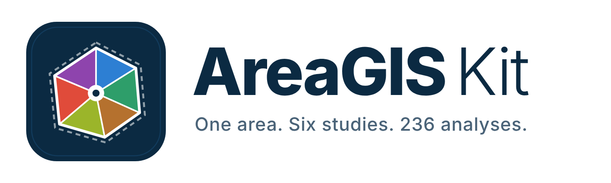

<p align="center"></p>
<p align="center">
<a href="https://pypi.org/project/areagiskit/"></a>
<a href="https://doi.org/10.5281/zenodo.24326878"></a>
<a href="https://github.com/Praddy-GByte/areagiskit/actions/workflows/tests.yml"></a>
<a href="LICENSE"></a>
<a href="https://github.com/Praddy-GByte/areagiskit/releases"></a>
<br>
<a href="https://plugins.qgis.org/plugins/areagiskit/"></a>
<a href="https://www.arcgis.com/home/item.html?id=1fdaab2a7bb14bd7a3e7b9fb8a5339f0"></a>
<a href="https://praddy-gbyte.github.io/areagiskit/"></a>
</p>

# AreaGIS Kit: an open-source research workflow for QGIS and ArcGIS Pro

**Documentation:** https://praddy-gbyte.github.io/areagiskit/ · **Download:** [latest release (beta)](https://github.com/Praddy-GByte/areagiskit/releases/latest):
`areagiskit.zip` is the QGIS plugin with all six kits (Plugins > Manage and Install Plugins > Install from ZIP);
`AreaGIS_Kit_for_ArcGIS_Pro.zip` is the ArcGIS Pro toolbox. Single-kit QGIS zips are also there for anyone who wants just one.
Problems or suggestions: [open an issue](https://github.com/Praddy-GByte/areagiskit/issues).

## Quick start

### Python

```python
from areagiskit.core.aoi import AOI
from areagiskit.kits import get

area = AOI(bbox=[67.6, 26.6, 67.9, 26.85], name="Dadu, Sindh")      # lon_min, lat_min, lon_max, lat_max
kit = get("floodstudy")()
result = kit.run(area, {"event_date": "2022-09-03"}, "out/dadu")

print(result["summary"])                  # key numbers in one line
print(result["verdict"]["level"])         # confidence grade: High / Medium / Low
print(result["report"])                   # out/dadu/report.html (also report.docx and report.pdf)
```

To use your own boundary instead of a box, pass its outline as WKT in longitude/latitude (EPSG:4326):

```python
from osgeo import ogr
ds = ogr.Open("district.gpkg")                     # a polygon layer in EPSG:4326
feature = ds.GetLayer(0).GetNextFeature()
area = AOI(wkt=feature.GetGeometryRef().ExportToWkt(), name="My district")
```

The six studies: `floodstudy`, `lulc`, `landslide`, `cropstudy`, `urbanstudy`, `healthstudy`.

### Command line

```bash
areagiskit list                           # every study and all its options

areagiskit floodstudy  --bbox 67.6 26.6 67.9 26.85     --name "Dadu, Sindh" event_date=2022-09-03 --out out/
areagiskit landslide   --bbox 76.08 11.43 76.22 11.56  --name "Wayanad"     event_date=2024-07-30 --out out/
areagiskit lulc        --bbox 76.98 28.40 77.08 28.48  --name "Gurugram"    years=2005,2015,2025  --out out/
areagiskit cropstudy   --bbox -88.75 36.62 -88.65 36.70 --name "Graves County" start=2021-01-01  --out out/
areagiskit urbanstudy  --bbox 76.98 28.40 77.10 28.50  --name "Gurugram"    year=2024 hot_months=4,5,6 --out out/
areagiskit healthstudy areas=wards.gpkg id_field=ward_id cases_field=cases population_field=pop --out out/
```

Each run writes `report.html`, `report.docx` and `report.pdf`, plus GeoTIFF and CSV results, in its output folder.

### QGIS and ArcGIS Pro

- **QGIS:** Plugins › Manage and Install Plugins › Install from ZIP › `areagiskit.zip`. Open a study from the
  **AreaGIS Kit** toolbar button or the Processing Toolbox, choose the area, press **Run**.
- **ArcGIS Pro:** unzip `AreaGIS_Kit_for_ArcGIS_Pro.zip`, then Catalog › Toolboxes › Add Toolbox › `AreaGIS Kit.pyt`.

### Install the Python package

```bash
conda create -n areagis -c conda-forge python=3.12 gdal numpy matplotlib scipy
conda activate areagis
pip install areagiskit
```

Full guide, every analysis and the data sources: **https://praddy-gbyte.github.io/areagiskit/**

AreaGIS Kit brings data acquisition, standard analyses, independent validation, confidence grading and reproducible
reporting into one run. Pick an area, fill in one or two options and press **Run**. Each kit fetches its own open data
(no account, no manual download), runs the standard analyses for its field, checks its results against independent
data where it can (High / Medium / Low confidence), and writes an HTML, Word and PDF report that explains every step
and says plainly what the results cannot tell you.

The methods are established, published methods. What AreaGIS Kit adds is putting them together into one reliable,
checked and reproducible workflow inside QGIS, and (beta) inside ArcGIS Pro.

| Kit | What it does | How it is checked |
|---|---|---|
| **AreaGIS Kit: Flood** | Sentinel-1 flood extent, history, depth, impact, damage, flood-prone zones, river flow | Copernicus EMS expert maps (52 floods), radar re-detection, dry-date false alarms |
| **AreaGIS Kit: LULC** | Landsat land cover since 1985, change, transitions, Sentinel-2 10 m map, projection | Your labelled sample (Olofsson), ESA CCI, change persistence |
| **AreaGIS Kit: Landslide** | Automatic Sentinel-2 inventory, 10 susceptibility models, slope stability, runout, hindcast | Spatial block CV, temporal test, hindcast of a dated event, your inventory |
| **AreaGIS Kit: Crop** | Seasons, intensity, crop groups, paddy rice (radar), drought, irrigation, residue burning | Reported yields (Kentucky), MODIS cross-checks, USDA CDL and LANID where available |
| **AreaGIS Kit: Urban** | Day/night heat island, heat stress, green space, vulnerability, access, air quality | Landsat vs MODIS, Meta vs GHS population |
| **AreaGIS Kit: Health** | Rates, SMR, smoothing, clusters, Kulldorff scan, Bayesian mapping, environment drivers | Exact match with PySAL, R-INLA and SpatialEpi; planted-cluster tests |

## AreaGIS Kit: Flood

Give an area (and a flood date if you know it; otherwise the largest flood on record is chosen).

The kit builds on Copernicus Global Flood Monitoring (GFM), the free EU service that maps floods on every Sentinel-1
pass since 2015. It does not reinvent the flood extent; it uses GFM as an input and adds what GFM does not provide:

1. The event: peak-date flood map, a timeline from −15 to +45 days, maximum extent
2. Flood duration (days under water)
3. Water depth (FwDET) and volume, with a reliability test (flat land is reported as unreliable)
4. Impact: population (GHS-POP), building footprint (GHS-BUILT), crops, trees and built-up land, roads, schools and hospitals (OSM)
5. Impact by depth class (<0.5, 0.5–1, 1–2, >2 m)
6. Damage: JRC global depth–damage curves (Huizinga 2017) by continent; money only if you give asset values
7. History since 2017: how often each place flooded, area per year, monthly pattern, top floods
8. Trend: Mann-Kendall and Sen's slope
9. Susceptibility: 11 factors built automatically, with a flood inventory taken from the satellite history
10. Four models (Frequency Ratio, AHP, Logistic Regression, Random Forest) and an ensemble
11. VIF, ROC curves, AUC, five classes with flood density and exposure per class
12. Checks: 30% hold-out AUC (optimistic, same inventory), temporal test, AUC against GloFAS
13. Independent radar re-detection and a Sentinel-2 optical check
14. Copernicus EMS expert maps found and compared automatically (CSI, F1)
15. Your own observed flood polygon or zones, if you have them
16. Rainfall (NASA POWER, 1981 on): 1–30 day totals before the event, Gumbel return periods, trends
17. River flow (GloFAS, 1984 on): hydrograph, return period of the peak, days above danger flow
18. River flow vs flooded area, and the area expected at 10- and 100-year flows
19. Event rank and recession speed
20. Settlements affected, one by one, and places cut off by water
21. Hazard (depth × duration), risk, vulnerability (including poverty, RWI) and Gi* hot spots
22. Crop damage from Sentinel-2 NDVI before and after
23. Encroachment into flood zones (1990–2020) and exposure in 10/100/500-year model zones
24. River-flow forecast (GloFAS ensemble, about seven months), stated as an outlook without a local skill score
25. Water hidden under trees, crops and between buildings (radar double bounce), as candidates only
26. 10/100-year flood depth from a HAND model calibrated on the observed flood, for screening only
27. Nearest safe high ground for each flooded settlement (straight-line distance, not a checked route)
28. Report with a proof appendix listing every GFM tile

**Benchmark: 52 real floods in 20 countries** against Copernicus EMS expert maps made from other satellites
(ICEYE, COSMO-SkyMed, TerraSAR-X, PAZ, RADARSAT-2, SPOT, WorldView), leave-event-out:

| 52 floods, never seen in training | GFM alone | GFM + change detection | **This kit (CNN)** |
|---|---|---|---|
| CSI (mean / median) | 0.39 / 0.41 | 0.44 / 0.47 | **0.46 / 0.49** |
| Share of expert flood found | 49% | 59% | **69%** |
| Share of mapped flood that was correct | 69% | 66% | 61% |
| Large floods (≥ 20 km², 17 events), CSI | 0.47 | 0.53 | **0.56** |

About a quarter of the expert-mapped flood is invisible to radar (water under crops and trees, wet soil), and expert
images are 0–36 hours from the radar pass. Depth has not been checked against measured depths.

## AreaGIS Kit: LULC

Give an area and years (default 1995, 2005, 2015, 2025).

- Cloud-free Landsat composites (5/7/8/9, harmonised), seven indices, Random Forest per year
- Training labels without fieldwork: pixels where Esri and ESA WorldCover 2021 agree, and unchanged pixels for older years
- Built-up history from JRC GHSL
- Accuracy: hold-out on the automatic labels (optimistic, not independent), ESA CCI for older years (independent),
  and an Olofsson stratified sample you can label for a true area-adjusted accuracy
- Change: transition matrices, gain/loss/swap, annual rates, intensity analysis, persistence, Gi* hot spots
- Landscape metrics (FRAGSTATS definitions) and landscape ecological risk
- Urban growth: rate, direction, density gradient, infill/edge/outlying, sprawl, SDG 11.3.1, drivers (logistic, Geodetector, GWR)
- Environment: LST and its trend, RSEI, UTFVI, carbon (IPCC Tier 1), habitat quality, ecosystem value (Costanza 1997),
  runoff (SCS-CN) and RUSLE C. These use transferred coefficients and are estimates, not measurements.
- Sentinel-2 10 m map of the latest year and tree-cover loss alerts
- Future maps (Markov–CA) and three scenarios, produced only if the method passes its own hindcast
- Your own classes and points, master plan comparison, census correlation, ward tables

## AreaGIS Kit: Crop

Cropland mask, a 10-day Sentinel-2 NDVI calendar, sowing/peak/harvest per season, cropping intensity, crop groups
without field data, paddy rice from Sentinel-1, a named crop map from your points, field boundaries and zones,
drought (VCI, TCI, VHI, SPI, soil moisture), evapotranspiration, irrigated vs rainfed, residue burning since 2001, and a
productivity anomaly since 2001 from MODIS GPP (a yield proxy, not yield).

Checks (Kentucky): the MODIS productivity anomaly picked 2007 and 2012 as the worst years (r = 0.78 with reported corn
yield) but understates the size of losses (2012: −19% vs about −58%); the Vegetation Health Index agrees with the MODIS
productivity record (r = 0.75 over 22 seasons). Checks of the Sentinel-2 based outputs (double cropping, rice, irrigation) against USDA CDL and
LANID are being repeated after the Sentinel-2 fix in v0.13 and will be published with the results.

## AreaGIS Kit: Landslide

Automatic Sentinel-2 inventory (greenest NDVI per year compared with the year before), a recovery test that drops
"scars" that are green again a year later (pruned tea, harvested plantations), dating of each scar between two
satellite views, 15+ conditioning factors, ten susceptibility models with spatial block cross-validation, a temporal
test, relative slope stability (textbook soil strengths, not site tests), debris runout (Flow-R style), risk,
settlements at risk, observed frequency per class, and field check points.

**Hindcast:** give an event date and the kit rebuilds the susceptibility and runout maps from scars seen before the
event only, then tests them on the event itself.

**Wayanad, 30 July 2024 (hindcast):** the pre-event map flagged the published source area and 100% of the first
2.5 km of the debris path; about 30% of the next 1.5 km (the village reach) and 29% beyond. The default 11° travel angle is
too short for this ~8 km debris flow (observed angle about 5.5°). Rainfall from the ~50 km NASA POWER cell was 88 mm
against 573 mm at a local gauge, so rainfall from global data does not measure the local trigger.

Earlier checks against independent inventories (Hiroshima, Sikkim, Gapyeong) were made before the Sentinel-2 fix in
v0.13 and are being repeated; they will be published once re-run.

## AreaGIS Kit: Urban

Surface temperature (Landsat), day and night heat island against a matched countryside ring (MODIS) with its trend
since 2003, hot spots, UTFVI, park and water cooling, tree canopy, green space per person, 3-30-300, heat
vulnerability, access to hospitals and schools, built-up growth, building on low land, NO₂ column (Sentinel-5P),
PM2.5 (CAMS), hourly air temperature, heat index, WBGT and UTCI (from ~50 km NASA POWER cells), Local Climate Zones,
building height, albedo and a +10% canopy scenario.

Gurugram 2024: Landsat vs MODIS on the same day r = 0.81; parks 4.0 °C cooler with an effect to about 300 m.

## AreaGIS Kit: Health

Your areas and case counts (CSV or layer). Population from Meta's 30 m map if you have none. Rates with 95% intervals,
SMR, empirical Bayes, Moran's I, LISA, Gi* with FDR, Kulldorff scan, BYM2 Bayesian mapping (own MCMC, no INLA needed)
with satellite covariates, Spearman, Geodetector, Poisson regression and GWPR, space-time scans, Knox test, emerging hot
spots, access (2SFCA), early warning and a next-period forecast (tested on simulations only), and a planted-cluster
test on your own map. Areas with fewer than 5 cases have their counts and crude rates hidden by default.

Checks on the NC SIDS data: Moran's I, LISA and empirical Bayes identical to PySAL; BYM2 relative risks correlate
0.9997 with R-INLA; the scan finds the same 42-county cluster as R SpatialEpi.

## Changes in v0.13 and v0.14 (AreaGIS Kit)

- Landslide hindcast (see above).
- Sentinel-2 fix: some older tiles are listed twice on Planetary Computer (original and ESA reprocessing with a +1000
  offset). Each tile now gets its own offset and duplicates are removed. This affected Landslide, Crop, the LULC
  Sentinel-2 map and the Flood optical check; earlier validation numbers are being re-run.
- Recovery test for landslide scars; confidence capped at Low when automatic scars are implausibly extensive.
- LULC no longer calls WorldCover/Esri agreement independent; projections stop if the hindcast fails.
- Health small-number suppression (`suppress_below`, default 5).
- Every report opens with "What this report will not tell you".
- Clearer names: relative slope stability classes, GPP productivity anomaly, simple-model UTCI in shade.

## The report

Each run writes `report.html`, `report.docx` and `report.pdf`. The first page has the key numbers, the confidence
grade, the main map and the list of things the report cannot tell you. Then: study area, data, method, results,
validation, limitations, conclusions, references, a proof appendix and a list of files. Every map has a title,
grid, north arrow, scale bar, legend, inset, projection and source.

## How to check the results yourself

- **Proof appendix:** the ID of every satellite scene used, with a link to its public record.
- **Rerun command:** the exact command to repeat the analysis and get the same numbers.
- **Validation table:** every check, what it compares against and whether it is independent. The confidence grade is
  computed from these checks, never typed in.
- **Field points:** random points to check on imagery or in the field.

## Install

QGIS 3.22 or later → **Plugins → Manage and Install Plugins → Install from ZIP** → choose a kit's zip.
Each kit adds a toolbar button and appears under **Processing Toolbox**. Only an internet connection is needed; GDAL
and numpy come with QGIS, so nothing has to be installed with pip. Because each kit is a Processing algorithm, batch
mode, the Model Builder and `qgis_process` work too.

## Command line (without QGIS)

```
python -m areagiskit.cli list
python -m areagiskit.cli floodstudy --bbox 71.83 30.72 72.21 31.29 --name Trimmu event_date=2025-08-30 --out out
python -m areagiskit.cli landslide --bbox 76.08 11.43 76.22 11.56 --name Wayanad event_date=2024-07-30 activity_years=7 --out out
python -m areagiskit.cli healthstudy areas=wards.gpkg id_field=ward_id cases_field=cases population_field=pop --out out
```

## Structure

```
areagiskit/
  core/        data access, equal-area grid, rasters, report builder (no QGIS code)
  kits/        one module per kit; each declares its PARAMS once
  cli.py       command line
  qgis_*.py    QGIS plugin: the Processing provider builds its forms from PARAMS
  arcgis_tools.py, arcgis/AreaGIS Kit.pyt   ArcGIS Pro Python toolbox, forms built from the same PARAMS
build_plugins.py   builds one self-contained plugin zip per kit, plus the ArcGIS Pro toolbox zip
```

A new kit is one module in `kits/` and one line in `kits/__init__.py`; the QGIS form, ArcGIS Pro tool, command line and report follow.

## ArcGIS Pro (beta)

Unzip `AreaGIS_Kit_for_ArcGIS_Pro.zip`, then in ArcGIS Pro: Catalog > Toolboxes > Add Toolbox > `AreaGIS Kit.pyt`.
Each kit is one tool with the same options and the same HTML, Word and PDF report; result layers are added to the
active map. The kits need GDAL's Python package; if a tool shows a GDAL warning, clone the `arcgispro-py3`
environment in the Package Manager and add the `gdal` package. The toolbox has been tested with a stand-in for arcpy
(forms for all six kits and a full Health run); it has not yet been run inside ArcGIS Pro itself.

## Licences

Code: GNU GPL v3.0 or later, with additional terms in `NOTICE`: keep the author credit, mark changed
versions as changed, and do not use the name "AreaGIS Kit" or its icons for a modified version.
Data: see `DATA_LICENSES.md` (RWI, GEM and Open-Meteo data are non-commercial).

## Python package

The engine and command line (no QGIS needed) are also available from PyPI. AreaGIS Kit needs GDAL's Python
bindings; with conda:

```
conda create -n areagis -c conda-forge python=3.12 gdal numpy matplotlib scipy
conda activate areagis
pip install areagiskit
areagiskit list
```

## How to cite

Kaushik, P. (2026). AreaGIS Kit: one-click geospatial studies for QGIS and ArcGIS Pro [Software].
Zenodo. https://doi.org/10.5281/zenodo.24326878

## Contributing

AreaGIS Kit is developed by one author. Bug reports and suggestions are welcome as GitHub Issues;
pull requests are not accepted at this time.
Before publishing, set `email`, `tracker` and `repository` in `build_plugins.py`.

Author: Pradeepika Kaushik.
